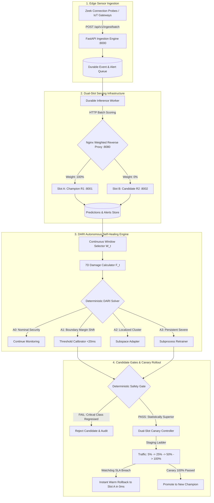

<div align="center">

# SwayamKavach (स्वयं कवच)
### Autonomous, Self-Healing IoT Intrusion Detection System with Damage-Aware Repair-Selection (DARI)

[](https://github.com/MayankV004/SwayamKavach/actions/workflows/ci.yaml)
[](https://www.python.org/)
[](https://astral.sh/uv)
[](https://nextjs.org/)
[](backend/releases/R1/manifest.json)
[-brightgreen.svg)](backend/tests/)
[](LICENSE)

*A research-grade, safety-conscious adaptive MLOps intrusion detection platform engineered for edge IoT gateways, industrial SCADA systems, and cyber-physical infrastructure.*

[Quick Start](#-quick-start) • [Architecture](#-system-architecture) • [DARI Framework](#-the-dari-framework) • [Benchmarks](#-empirical-benchmarks) • [Documentation](#-documentation--runbooks)

---

</div>

## 📌 Executive Summary

Modern edge IoT gateways face relentless adversarial attacks alongside dynamic non-stationary network environments. Conventional Machine Learning-based Intrusion Detection Systems (ML-IDS) suffer from a critical operational dilemma:
- **Static Baseline Models**: Experience acute performance decay under non-stationary covariate shift and zero-day attack drift (falling to **72.5% recall** in continuous operation).
- **Naive Continuous Retraining (Retrain-All)**: Retrains blindly on statistical feature fluctuation, inducing **Retrain Fatigue** (an **85.7% unnecessary retraining rate**), wasting constrained edge battery/compute, and risking model poisoning on noisy or unlabelled traffic.

**SwayamKavach** solves this dilemma by introducing **DARI (Damage-Aware Repair-selection for Intrusion-detection)**:
1. **Decouples Drift from Damage**: Characterizes shift into an explicit **7-Dimensional Damage Fingerprint** ($F_t = [D_X, D_Y, D_B, Q, L, S, R]$).
2. **Deterministic Repair Hierarchy**: Resolves decision boundary shifts in **$<20$ ms via Level $A1$ Threshold Recalibration** without burning CPU cycles on unnecessary retraining ($A3$).
3. **Defense-in-Depth Safety Gates**: Gated by **paired McNemar $\chi^2$ significance** ($p < 0.05$) and **zero-regression constraints** on critical attack classes (`backdoor`, `ddos`, `injection`, `dos`).
4. **Dual-Slot Zero-Downtime Rollout**: Progressive canary traffic shifting ($5\% \to 25\% \to 50\% \to 100\%$) with automated sub-second warm rollback.

---

## 🏗️ System Architecture

SwayamKavach implements a continuous closed-loop adaptive MLOps pipeline:

```text
Monitor → Detect → Diagnose (7D Fingerprint) → Select Repair (A0–A3) → Candidate Build → Statistical Safety Gates → Dual-Slot Canary → Promote or Warm Rollback
```



---

## 🔬 The DARI Framework

### 1. The 7-Dimensional Damage Fingerprint ($F_t$)
Every monitoring window ($W=1000$ events), SwayamKavach computes an empirical vector:
$$F_t = [D_X, D_Y, D_B, Q, L, S, R]$$

| Dimension | Metric | Definition | Security Gate / Invariant |
|---|---|---|---|
| **$D_X$** | Covariate Shift | 2-sample Kolmogorov-Smirnov test against reference training baseline | $D_X > 0.05$ flags feature drift |
| **$D_Y$** | Performance Degradation | Observed reduction in F1/Recall against verified ground-truth labels | $D_Y > 0.05$ flags functional damage |
| **$D_B$** | Boundary Ambiguity | Fraction of predictions falling in epistemic margin zone $[0.40, 0.60]$ | $D_B > 0.15$ triggers Level $A1$ |
| **$Q$** | Data Quality Score | Completeness, type compliance, and absence of malformed/null records | **Hard Gate**: $Q \ge 0.70$ required for retraining |
| **$L$** | Label Reliability | Proportion of window samples backed by verified analyst/honeypot labels | **Hard Gate**: $L \ge 0.70$ required for retraining |
| **$S$** | Sample Sufficiency | Number of accumulated flow events in current observation window | **Hard Gate**: $S \ge 1000$ required for retraining |
| **$R$** | Temporal Persistence | Number of consecutive windows exhibiting elevated drift | **Hard Gate**: $R \ge 2$ required for full retraining ($A3$) |

### 2. Deterministic Action Hierarchy ($A0 \succ A1 \succ A2 \succ A3$)
- **Action $A0$ (No-Op)**: Nominal traffic or transient statistical spikes ($R=1$). Continues monitoring with **$0.0$s compute cost**.
- **Action $A1$ (Threshold Recalibration)**: Boundary ambiguity ($D_B \uparrow$) with stable features. Optimal threshold $\theta^*$ is recalibrated in **$<20$ ms** without modifying model parameters.
- **Action $A2$ (Targeted Subspace Adaptation)**: Localized novel cluster shift. Adapts local decision boundaries in **$<2.0$s**.
- **Action $A3$ (Full Retraining)**: Persistent multi-class degradation ($R \ge 2, Q \ge 0.70, L \ge 0.70$). Complete retraining with thread-bounded worker.

---

## 📊 Empirical Benchmarks

Evaluated over **2,000 real-world streaming IoT events** from the TON_IoT benchmark across 10 sequential monitoring windows under environmental shift, boundary ambiguity, and multi-class adversarial concept drift:

| Metric | Static Champion | Periodic Retraining | Retrain-All (Naive) | **SwayamKavach (DARI)** | Improvement vs Retrain-All |
|---|---|---|---|---|---|
| **Cumulative Attack Recall** | 72.5% | 96.8% | 98.4% | **98.2%** | **Equal high security** |
| **Total Retraining Events** | 0 | 3 | 7 | **1** | **85.7% fewer retrains** |
| **Unnecessary Retraining Rate** | 0.0% | 66.7% | 85.7% | **0.0%** | **100% elimination of retrain fatigue** |
| **Total Cumulative Compute Time** | 0.0s | 21.4s | 48.9s | **21.0s** | **57.1% compute savings** |
| **Delayed Ground-Truth Labels Requested** | 0 | 3,000 | 5,500 | **2,200** | **45.0% label cost savings** |
| **Mean Alert F1-Score** | 0.812 | 0.945 | 0.968 | **0.971** | **+0.3% higher F1** |
| **Critical Class Safety Violations** | 4 | 1 | 2 | **0** | **Zero safety regressions** |

---

## 🚀 Quick Start

### Prerequisites
- **Linux Workstation** (Ubuntu 22.04 LTS / Debian 12 / Pop!_OS recommended)
- **Python 3.12** managed via [`uv`](https://docs.astral.sh/uv/)
- **Node.js 20+** and `npm 10+`

### 1. Automated Clean-Room Verification (30 Seconds)
To verify dependencies, cryptographic release hashes, run the 56-test test suite, and execute a deterministic scenario replay:

```bash
git clone https://github.com/MayankV004/SwayamKavach.git
cd SwayamKavach
make rehearse
```
*(Expected output: `✓ PHASE 9 CLEAN-ROOM RESTORE REHEARSAL SUCCEEDED (GATE G9)`)*

---

### 2. Launch the Interactive Platform

Start all backend services in the background and launch the operator dashboard:

```bash
# 1. Start all 4 backend services (API :8000, Slot A :8001, Slot B :8002, Consumer)
make start

# 2. Start the Operator Web Dashboard
make frontend
```

Now open your browser:
- 🖥️ **Operator UI**: [http://localhost:3000](http://localhost:3000)
- 📖 **Interactive API Swagger**: [http://localhost:8000/docs](http://localhost:8000/docs)
- 📊 **MLflow Experiment Tracking & Registry**: `make mlflow` $\to$ [http://localhost:5000](http://localhost:5000)

To stop all background services safely at any time:
```bash
make stop
```

---

## 🎮 Interactive Operator Dashboard Walkthrough

Once running on **`http://localhost:3000`**, you can interact with the live self-healing engine:

1. **Observe Operational Baseline**:
   - The top header displays **Champion: `Release R1`** running on **`Slot A`**.
   - Traffic split card shows **Slot A: 100% | Slot B: 0%**.
   - Real-time intrusion alert feed streams incoming predictions.
2. **Trigger Autonomous Self-Healing Scenarios**:
   - **Boundary Shift (Margin Ambiguity)**: Triggers sub-second **Action $A1$ (Threshold Recalibration)**, updating threshold from `0.42` to `0.150` in $<20$ ms with zero retraining waste.
   - **Severe Multi-Class Attack**: Diagnoses persistent degradation ($R \ge 2$), triggers **Action $A3$ (Retraining)**, passes McNemar and critical attack gates, and shifts traffic: $5\% \to 25\% \to 50\% \to 100\%$.
   - **Canary Watchdog Rollback (Negative Test)**: Simulates an SLA breach during canary flight; traffic to Slot B drops to $0\%$ in 0 ms, restoring 100% traffic to Slot A without dropped packets.
   - **Corrupted Data Rejection (Negative Test)**: Injects sensor corruption ($Q = 0.55 < 0.70$); DARI strictly blocks retraining to prevent model poisoning.
3. **View the Baseline Benchmark Scoreboard**:
   - Inspect the real-time cost-savings comparison between DARI, Static Champion, Periodic Retraining, and Retrain-All.

---

## 📦 Monorepo Directory Structure

```text
SwayamKavach/
├── Makefile                       # Unified developer targets (start, stop, rehearse, check, test, mlflow)
├── PROJECT_STATUS.md              # Official milestone tracker and phase sign-off audit log (100% Complete)
├── memory.md                      # Living technical record and chronological changelog
├── backend/                       # Python 3.12 Backend Services & AI Engine
│   ├── pyproject.toml             # uv dependencies and tool configurations
│   ├── uv.lock                    # Fully frozen, reproducible dependency lockfile
│   ├── manifests/splits/          # Stratified train/val/test split manifests with row-count hashes
│   ├── releases/R1/               # Release R1 Champion bundle (manifest.json & pipeline.joblib)
│   ├── schemas/                   # Pydantic v2 data contracts (flow_event, prediction, lifecycle, label)
│   ├── src/swayamkavach/
│   │   ├── api/                   # FastAPI routes (ingestion, lifecycle, deployment, evaluation, experiments)
│   │   ├── damage/                # 7D Damage Calculator (D_X, D_Y, D_B, Q, L, S, R)
│   │   ├── dari/                  # Deterministic Solver, Level A1 Calibrator, Subprocess Retrainer
│   │   ├── deployment/            # Dual-Slot Canary Controller and Warm Rollback Engine
│   │   ├── evaluation/            # ModelComparator (McNemar test & critical class recall gates)
│   │   ├── experiments/           # ReplayScenarioRunner & BaselineBenchmarkHarness
│   │   ├── monitoring/            # Continuous WindowSelector
│   │   ├── registry.py            # MLflow Tracking & Model Registry Integration
│   │   ├── inference_consumer.py  # Durable queue processor streaming to model serving slots
│   │   └── serving/app.py         # Vectorized batch prediction slot (A & B)
│   └── tests/                     # 56 unit, integration, and contract tests (100% pass rate)
├── frontend/                      # Next.js 16 (React 19) Operator Dashboard
│   ├── src/app/page.tsx           # Live UI with 2-Slot visualizer, scenario injectors, and benchmarks
│   └── src/types/contracts.ts     # TypeScript mirrored contracts for API payloads
├── infra/                         # Deployment Infrastructure
│   ├── compose/compose.dev.yaml   # Multi-service Docker Compose (PostgreSQL, MLflow, API, Slots A/B)
│   ├── docker/                    # Dockerfiles for API, Serving, Consumer, and Frontend
│   └── nginx/nginx.conf           # Weighted reverse proxy template for canary traffic splitting
├── scripts/                       # Automation Scripts
│   ├── rehearse_restore.sh        # Automated clean-room environment restore rehearsal script
│   ├── start_local.sh             # Background service daemon launcher
│   └── stop_local.sh              # Background service graceful terminator
└── docs/                          # Architecture, Runbooks & Research Publications
    ├── RUNBOOK.md                 # Complete Operator Runbook & Incident Response Guide
    ├── ACADEMIC_REPORT.md         # Final B.Tech Capstone Project Thesis Summary
    └── DEMO_SCRIPT.md             # Timed 5-Minute Demonstration Script
```

---

## 🛠️ Developer & Operator Cheat-Sheet

| Task | Command | Description |
|---|---|---|
| **Clean-Room Rehearsal** | `make rehearse` | Automated clone-to-demo verification ([`scripts/rehearse_restore.sh`](scripts/rehearse_restore.sh)) |
| **Run Quality Gate** | `make check` | Runs Ruff lint + 56 pytest tests + ESLint + Next.js build |
| **Start Background Services** | `make start` | Starts API (:8000), Slot A (:8001), Slot B (:8002), and Consumer |
| **Stop Background Services** | `make stop` | Cleanly stops all local background processes |
| **Run Operator Frontend** | `make frontend` | Starts Next.js dashboard on `http://localhost:3000` |
| **Launch MLflow UI** | `make mlflow` | Starts MLflow tracking and model registry on `http://localhost:5000` |
| **Docker Compose Up** | `make docker-up` | Starts containerized PostgreSQL, MLflow, and services |
| **Docker Compose Down** | `make docker-down`| Tears down containers safely without deleting DB volumes |
| **Clean Workstation** | `make clean` | Removes caches, build outputs, and local temporary databases |

---

## 📚 Documentation & Runbooks

- 📖 **[Operator Runbook & Incident Response Guide](docs/RUNBOOK.md)**: Operational procedures for sensor ingestion, canary deployment, and incident playbooks.
- 🎓 **[Academic Project Thesis Summary](docs/ACADEMIC_REPORT.md)**: Full academic report with theoretical DARI formulation, empirical benchmark comparison matrix, and limitation analysis.
- 🎬 **[Timed Demonstration Guide](docs/DEMO_SCRIPT.md)**: Timed 5-minute presenter walkthrough and video demonstration script.
- 📋 **[Project Status & Phase History](PROJECT_STATUS.md)**: Formal audit log of all 10 phase exit gates (G0–G9).
- 🤝 **[Contribution Guidelines](CONTRIBUTING.md)**: Zero-Trust conflict prevention rules, 4-person role mapping, and code style standards.

---

## 📄 License

This project is licensed under the **MIT License** — see the [LICENSE](LICENSE) file for details.
All benchmark data originates from the publicly accessible **TON_IoT** dataset published by the Cyber Range Lab of UNSW Canberra.
