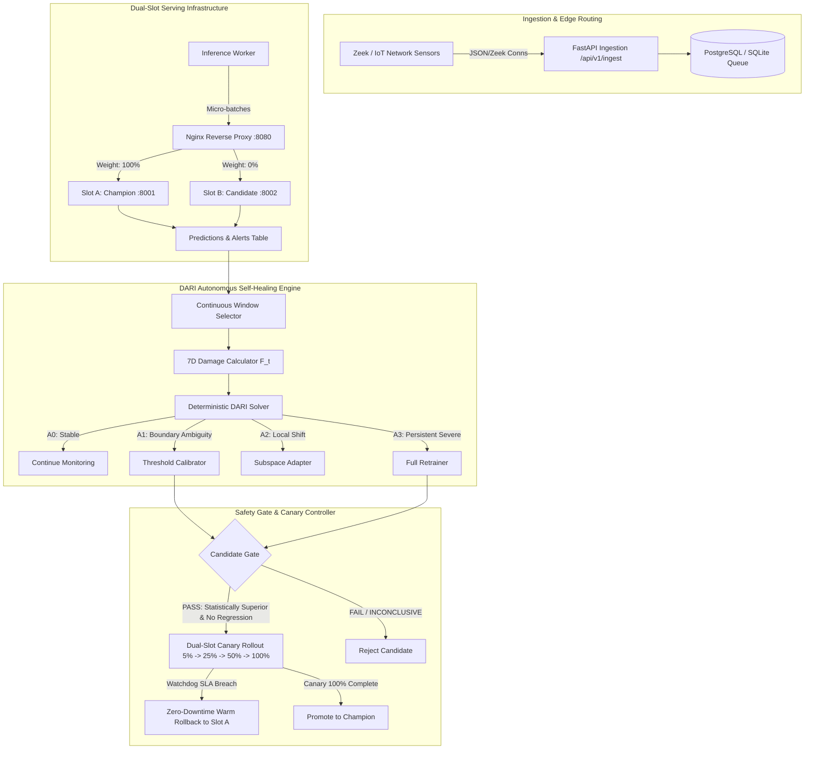

# SwayamKavach — Operator Runbook & Incident Response Guide

> **System Classification**: Research-Grade Autonomous Self-Healing IoT Intrusion Detection System (IDS)  
> **Target Audience**: Security Operations Center (SOC) Analysts, Edge Infrastructure Engineers, MLOps Practitioners  
> **Release Baseline**: Release `R1` (HistGradientBoosting, calibrated threshold $\theta^* = 0.42$)  
> **Version**: 1.0.0 (Phase 9 Release Freeze)

---

## 1. System Overview & Architecture

SwayamKavach is an autonomous, self-healing intrusion detection platform designed specifically for edge IoT networks (e.g., smart home, industrial gateways, medical sensors). Unlike conventional IDS systems that either remain statically vulnerable to concept drift or blindly trigger expensive full retraining upon any statistical fluctuation, SwayamKavach implements **DARI (Damage-Aware Repair-selection for Intrusion-detection)**.



---

## 2. Environment Startup & Service Lifecycle

### 2.1 Prerequisites
- **Linux Workstation** (Ubuntu 22.04 LTS / Debian 12 / Pop!_OS recommended)
- **Python 3.12** managed via [`uv`](https://docs.astral.sh/uv/)
- **Node.js 20+** and `npm 10+`
- **Docker & Docker Compose** (Optional, for containerized deployment)

### 2.2 Local Development Startup (Recommended for Demo & Debugging)

To start the complete platform natively on the host workstation:

```bash
# 1. Synchronize backend virtual environment and verify lockfile
cd backend
uv sync --frozen

# 2. Start PostgreSQL or use default zero-config SQLite database
# Database schema auto-initializes upon server startup
export DATABASE_URL="sqlite:///./swayamkavach_dev.db"

# 3. Start Backend API Control Plane (Port 8000)
uv run uvicorn swayamkavach.api.main:app --host 0.0.0.0 --port 8000 --reload &

# 4. Start Champion Model Serving Slot A (Port 8001)
SLOT_ID=A RELEASE_ID=R1 uv run uvicorn swayamkavach.serving.app:app --host 0.0.0.0 --port 8001 &

# 5. Start Candidate Model Serving Slot B (Port 8002, warm standby)
SLOT_ID=B RELEASE_ID=R1 uv run uvicorn swayamkavach.serving.app:app --host 0.0.0.0 --port 8002 &

# 6. Start Durable Inference Consumer
uv run python src/swayamkavach/inference_consumer.py &

# 7. Start Next.js Operator Dashboard (Port 3000)
cd ../frontend
npm run dev
```

The operator dashboard will be accessible at: `http://localhost:3000`  
The API Swagger documentation will be accessible at: `http://localhost:8000/docs`

### 2.3 Containerized Startup via Docker Compose

```bash
# Start all microservices in background:
# postgres (:5432), api (:8000), serve_a (:8001), serve_b (:8002), consumer, mlflow (:5000)
make docker-up

# Check container health and logs:
docker compose -f infra/compose/compose.dev.yaml ps
docker compose -f infra/compose/compose.dev.yaml logs -f api

# Teardown infrastructure safely without destroying persistent volumes:
make docker-down
```

---

## 3. Sensor Configuration & Ingestion Protocol

### 3.1 Ingestion Contract
Network sensors (e.g. Zeek `conn.log` collectors or edge probes) POST micro-batches of flow events to:
`POST http://localhost:8000/api/v1/ingest/batch`

**Payload Schema**:
```json
{
  "sensor_id": "sensor-gateway-north-01",
  "schema_version": "v1.0",
  "extractor_id": "zeek-conn-v3.2",
  "events": [
    {
      "event_id": "evt-20261015-001928-0001",
      "event_time": "2026-10-15T02:00:00Z",
      "features": {
        "duration": 0.045,
        "src_bytes": 1024,
        "dst_bytes": 4096,
        "src_ip_bytes": 1088,
        "dst_ip_bytes": 4160,
        "src_pkts": 12,
        "dst_pkts": 16,
        "missed_bytes": 0,
        "proto": "tcp",
        "service": "http",
        "conn_state": "SF"
      },
      "identifiers": {
        "src_ip": "192.168.1.105",
        "dst_ip": "10.0.0.1",
        "src_port": 49201,
        "dst_port": 80
      }
    }
  ]
}
```

### 3.2 Ingestion Invariants
1. **Idempotency**: Event IDs are unique. If a duplicate `event_id` is received, the consumer discards the duplicate gracefully without corrupting prediction state.
2. **Feature Sanitization**: Dashes (`-`) representing nulls in Zeek logs are automatically coerced into `0` for numeric columns and `"none"` for categorical variables.

---

## 4. DARI Self-Healing Diagnostics & Repair Hierarchy

### 4.1 The 7-Dimensional Damage Fingerprint ($F_t$)

Every monitoring window (configurable, default $W=1000$ events), the system computes:
$$F_t = [D_X, D_Y, D_B, Q, L, S, R]$$

| Metric | Name | Definition | Threshold / Gate |
|---|---|---|---|
| $D_X$ | Feature Covariate Drift | 2-sample Kolmogorov-Smirnov test against reference training distribution | $D_X > 0.05$ flags drift |
| $D_Y$ | Performance Degradation | Reduction in F1 / Balanced Accuracy vs Champion baseline | $D_Y > 0.05$ flags degradation |
| $D_B$ | Boundary Ambiguity | Fraction of predictions falling in uncertainty band $[0.40, 0.60]$ | $D_B > 0.15$ flags margin shift |
| $Q$ | Data Quality Score | Completeness, schema conformity, and lack of corrupt/missing values | **Hard Gate**: $Q \ge 0.70$ required for retraining |
| $L$ | Label Reliability | Proportion of delayed labels verified by analysts / honeytoken ground truth | **Hard Gate**: $L \ge 0.70$ required for retraining |
| $S$ | Sample Sufficiency | Number of accumulated observations in current window | **Hard Gate**: $S \ge 1000$ required for retraining |
| $R$ | Temporal Persistence | Consecutive monitoring windows exhibiting persistent drift | **Hard Gate**: $R \ge 2$ required for full retraining ($A3$) |

### 4.2 Repair Action Selection Hierarchy

The deterministic DARI solver selects the optimal action satisfying:
$$A^* = \arg\max_{A \in \mathcal{A}_{\text{feasible}}} U(A \mid F_t)$$

- **$A0$ (No Repair)**: Nominal traffic or transient statistical noise ($R=1$). System continues monitoring. Compute cost: **$0.0$s**.
- **$A1$ (Threshold Recalibration)**: High boundary ambiguity ($D_B > 0.15$) with stable feature representations. Optimal threshold $\theta^*$ is recomputed in sub-second time without model parameter changes. Compute cost: **$<0.05$s**.
- **$A2$ (Targeted Subspace Adaptation)**: Localized cluster drift with sufficient samples. Isolated subspace weighting adapted. Compute cost: **$<2.0$s**.
- **$A3$ (Full Retraining)**: Severe, persistent degradation across multiple classes ($R \ge 2, Q \ge 0.70, L \ge 0.70$). Model is retrained on updated window. Compute cost: **$5.0$–$30.0$s**.

> [!IMPORTANT]
> **DARI Invariant**: $A3$ is never the default action. Unlabelled streams ($L < 0.70$) or corrupted data ($Q < 0.70$) strictly forbid $A3$ to prevent model poisoning and retrain fatigue.

---

## 5. Candidate Evaluation & Approval Gates

Before any newly trained or adapted candidate model ($R_k$) can receive live traffic, it must pass through the **Deterministic Safety Gate** ([`ModelComparator`](file:///home/streamliner/btp/backend/src/swayamkavach/evaluation/compare.py)):

1. **Paired Statistical Significance (McNemar Test)**:
   - Evaluated on paired prediction contingency tables on the validation set.
   - Requires $p$-value $< 0.05$ and odds ratio $> 1.0$ (statistically superior).
2. **Zero-Regression on Critical Attack Classes**:
   - Critical classes: `backdoor`, `ddos`, `injection`, `dos`.
   - Invariant: Candidate recall on each critical class must be $\ge$ Champion recall ($R_{\text{cand}}(c) \ge R_{\text{champ}}(c) - 0.01$).
3. **Cryptographic Approval Manifest**:
   - If verdict is `PASS`, a SHA-256 approval hash is generated binding the candidate pipeline hash, evaluation metrics, and timestamp.
   - If verdict is `FAIL` or `INCONCLUSIVE`, the candidate is immediately discarded.

---

## 6. Two-Slot Canary Rollout & Emergency Warm Rollback

### 6.1 Progressive Canary Staging
When a candidate is approved, the **Canary Controller** ([`CanaryController`](file:///home/streamliner/btp/backend/src/swayamkavach/deployment/canary.py)) executes progressive flighting:

| Stage | Slot A (Champion) | Slot B (Candidate) | Observation Window | Watchdog Check |
|---|---|---|---|---|
| Stage 0 | 100% | 0% (Warm Standby) | — | Baseline health |
| Stage 1 | 95% | 5% | 100 requests | Latency $\le 150$ms, Error rate $< 1\%$ |
| Stage 2 | 75% | 25% | 250 requests | Latency $\le 150$ms, Error rate $< 1\%$ |
| Stage 3 | 50% | 50% | 500 requests | Latency $\le 150$ms, Error rate $< 1\%$ |
| Promotion | 0% (Standby) | 100% (New Champion) | Permanent | Slot B promoted to Champion |

### 6.2 Emergency Warm Rollback Procedure

If at any point during canary flighting the watchdog detects:
- Serving latency P99 $> 150$ms
- Server 5xx error rate $> 1.0\%$
- Sudden anomaly spike or crash

The system executes an **instant warm rollback**:
```bash
# Automated trigger via API:
curl -X POST http://localhost:8000/api/v1/deployment/rollback \
  -H "Content-Type: application/json" \
  -d '{"reason": "Manual operator intervention: Canary latency SLA breach"}'
```

**Rollback Invariants**:
- Traffic to Slot B drops to **0% in 0 milliseconds**.
- 100% traffic immediately returns to Slot A (existing Champion).
- Zero downtime; no containers need to be restarted.

---

## 7. Incident Response Playbooks

### Incident 1: High Covariate Drift Alert ($D_X > 0.20$)
1. **Diagnosis**: Check `/api/v1/monitoring/drift` to identify which features are drifting (e.g., `src_bytes`, `conn_state`).
2. **Action**: If $D_Y$ remains low and security performance is stable, verify DARI selects $A0$ (No Repair). Do not force retraining.
3. **Escalation**: If new IoT device types have been deployed on the edge network, ensure ground-truth labels for new traffic are submitted via `POST /api/v1/labels/delayed`.

### Incident 2: Sensor Data Corruption Alert ($Q < 0.70$)
1. **Diagnosis**: Inspect `/api/v1/experiments/scenarios/run` with `corrupted_data_rejection`.
2. **Action**: Check network parser logs for dropped packets, malformed headers, or truncated JSON records.
3. **Safety Protection**: Verify DARI has blocked retraining ($A3$ rejected). Replace or restart faulty edge sensor hardware.

### Incident 3: Critical Class Regression during Autonomous Retraining
1. **Diagnosis**: Review evaluation logs at `GET /api/v1/evaluation/reports/latest`.
2. **Verification**: Confirm evaluation verdict is `FAIL` with reason `Critical class recall regressed`.
3. **Outcome**: The candidate model is blocked at Gate G6; Champion continues uninterrupted.

---

## 8. Backup, Restore & Clean-Room Verification

### 8.1 Automated Verification Script
Run the automated Phase 9 verification script at any time:
```bash
./scripts/rehearse_restore.sh
```

### 8.2 Database Backup & Reset
- SQLite:
  ```bash
  # Backup current state:
  cp swayamkavach_dev.db swayamkavach_dev_backup.db
  # Reset to clean initial state:
  rm -f swayamkavach_dev.db
  make sync
  ```
- PostgreSQL:
  ```bash
  # Dump database:
  docker exec -t swayamkavach-postgres pg_dump -U swayam_user swayamkavach > backup.sql
  ```
