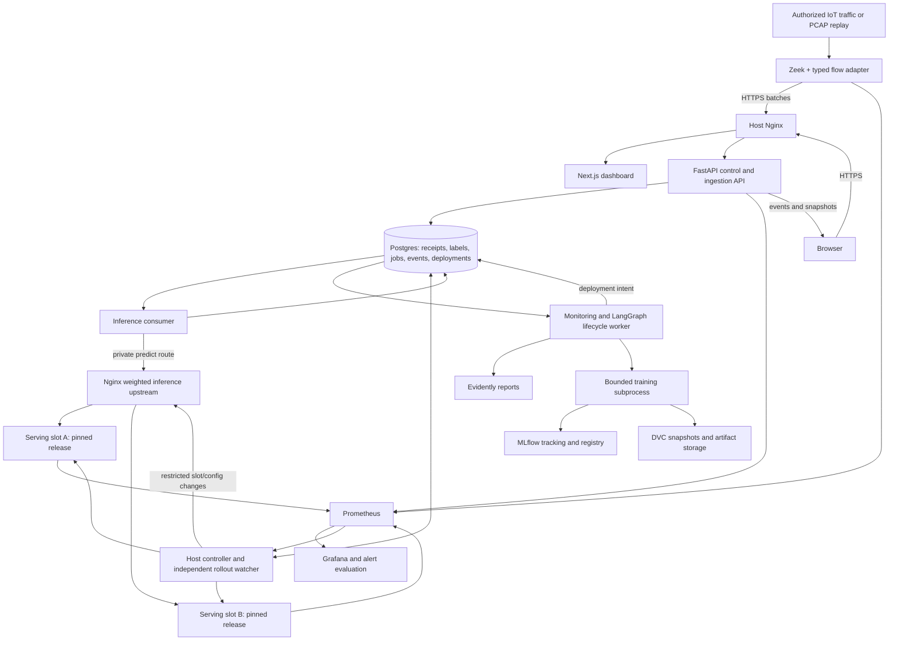

# SwayamKavach — 02 System Architecture

Shared reference architecture, topology, interfaces, state ownership, synchronous and asynchronous boundaries and recovery invariants.

## Topology and architecture choice

# 02 · System Architecture

**Recommended reference:** one recoverable Linux host, Docker Compose application services, host-managed Nginx, an authorized Zeek sensor, PostgreSQL, and two immutable serving slots. This is a student MVP, not a highly available cluster. Decisions remain conditional on actual infrastructure.



Prometheus arrows denote logical metric availability; Prometheus normally **pulls/scrapes** endpoints. Grafana is a visualization layer, not a training scheduler. Next.js never receives MLflow, database, Docker or LLM credentials.

### Why these boundaries?
- Flow extraction is outside model servers so both versions receive identical representations.
- Inference and lifecycle workers are separate processes: CPU-intensive training cannot block ingestion or prediction.
- The ingestion response acknowledges durable receipt, not a completed prediction.
- Agents submit typed intentions; a narrow controller is the only process permitted to mutate local serving/routing infrastructure.
- A watcher remains active after the graph job finishes and can initiate deterministic rollback without waiting for an LLM.

## Data flow and contracts

## Online data plane
1. Sensor closes/expires a connection and creates a `FlowEvent`. For long connections, this may be substantially later than the first packet.
2. FastAPI validates the sensor credential, schema version, sizes and event IDs. It transactionally records a batch receipt, flow references and inference work; returns `202 {batch_id, status: accepted}` only after commit.
3. An inference consumer claims work, sends bounded homogeneous-schema microbatches to the private Nginx route, then stores predictions and advisory alerts transactionally. Backpressure is visible as queue age, not hidden latency.
4. Every returned prediction includes the actual release and model version. Retrying an ambiguous request may re-execute inference, but only one authoritative prediction is committed per `(event_id, prediction_purpose)`. A separately identified shadow evaluation may coexist. Duplicate execution counters are distinct from committed prediction counters.
5. Later labels join by event ID and are never fed to the predictor. Label corrections are new revisions, not silent overwrites.

```text
FlowEvent
  event_id, sensor_id, capture_id, event_time, feature_ready_at
  extractor_id, schema_version, feature_values, quality_flags
  protected_metadata_ref

Prediction
  prediction_id, event_id, purpose, predicted_at, score, label
  positive_class, decision_threshold, release_id, model_version
  slot, inference_attempt_id, deployment_generation

LabelRecord
  event_id, label, label_revision, source, available_at
  adjudication_status, evidence_ref

DeploymentIntent
  operation_id, expected_generation, candidate_release_id
  action_type (HOT_THRESHOLD_UPDATE, CONTAINER_ROLLOUT)
  target_threshold, policy_revision, evaluation_hash
  approval_id, requested_weights

DamageFingerprintRecord
  window_id, dx, dy, db, q, l, s, r, computed_at, reference_id

RepairDecisionRecord
  decision_id, fingerprint_id, selected_action (A0, A1, A2, A3)
  feasible_actions, expected_recovery, cost_estimate, risk_penalty
  net_utility, rationale, created_at
```

`deployment_generation` is the router configuration generation observed by that request; the backend also reports its actual release identity. They answer different questions. Record both in the consumer. Old Nginx workers may still use an older generation while draining.

## Supervisory control plane (DARI-Guided)
Monitoring jobs freeze a window and reference → compute 7-dimensional Damage Fingerprint $F_t = [D_X, D_Y, D_B, Q, L, S, R]$ → evaluate evidence and feasibility constraints → DARI selector maximizes net utility $U(A_i) = R(A_i) - \lambda C(A_i) - \gamma G(A_i)$ among $\{A0, A1, A2, A3\}$ → build **only** the selected repair (A1 hot calibration or A3 DVC snapshot/retraining) → paired evaluation against security constraints → approval if required → deployment intent (hot threshold update or dual-slot canary) → canary observation → promotion or rollback. Reports live as artifacts; graph state contains identifiers and hashes.

## Sync versus async
| Boundary | Mechanism | Why |
|---|---|---|
| Browser reads / writes | HTTP snapshots; writes return 202 for long work | Responsive API and explicit status |
| Sensor receipt | Synchronous validation and durable commit | Safe retry from sensor spool |
| Flow inference | Async durable consumer; sync HTTP to serving slot | Decouple ingestion from model availability |
| Training / profiling | Jobs and subprocesses | CPU/resource isolation |
| Graph handoff | Persisted state transitions | Recoverable workflow, not inter-agent chat strings |
| Deployment | Durable intent + controller reconciliation | DB writes cannot atomically change Nginx |
| UI updates | SSE with event cursor, polling fallback | Replayable events; UI is not control authority |

For a lower-latency lab prototype, synchronous ingestion→inference is simpler, but clients then inherit model latency/outages. Choose it explicitly and retain durable retry semantics; this document standardizes the async form.

## State ownership and consistency

## Authoritative state
| State | Owner | Persistence / recovery |
|---|---|---|
| Receipts, operational flow index, predictions, labels | Application Postgres | Transactions, uniqueness constraints, retention/archival |
| Bulk curated features and snapshots | Parquet/object or protected filesystem storage | Immutable manifests, DVC remote, checksums |
| Jobs, leases, operation effects and UI events | Application Postgres | At-least-once workers, fencing and deduplication |
| Graph checkpoints | Postgres checkpointer tables | Stable thread/job ID; versioned workflow |
| Runs, parameters, model versions | MLflow backend DB | Separate database/credentials on same instance is acceptable |
| Model bundles and evaluation reports | MLflow artifact storage | Protected immutable release copies and checksums |
| Dataset/split/label revisions | Git metadata + DVC objects | Both metadata and bytes required to restore |
| Desired deployment | Application Postgres | Monotonic generation; expected-generation mutations |
| Applied traffic routing | Nginx config and running workers | Controller observes config hash/generation and slot identities |
| Metric time series | Prometheus | Bounded retention; not audit or label truth |
| Dashboard state | Derived API snapshots | Browser cache is disposable |

No distributed transaction spans PostgreSQL, DVC, MLflow and Nginx. Use an operation/effect ledger, immutable artifacts, staged changes and reconciliation rather than claiming exactly-once execution.

**Core invariants:**
- One active lifecycle/deployment mutation per model; one CPU training subprocess for MVP.
- All effects carry an operation ID; stale lease holders cannot promote.
- An approval binds candidate checksum, evaluation hash, policy revision and predecessor generation.
- Slots load exact releases; no polling a mutable `champion` alias inside serving.
- The previous healthy slot remains warm through stabilization. With two slots, a new candidate must wait until that retention period ends.
- Missing telemetry, failed schema checks and unknown labels cannot be treated as healthy/benign.
- Intrusion alerts never automatically become training labels.

**Queue implementation:** short `FOR UPDATE SKIP LOCKED` claim transaction, record lease/owner/attempt, commit, execute outside the transaction, then acknowledge. Checkpoint persistence is not a substitute for idempotency of external effects. [1–2]

## Failure behavior, alternatives and references

## Failure matrix
| Failure | Required behavior |
|---|---|
| Sensor→API outage | Bounded disk spool, retry/backoff, expose dropped/expired events |
| Postgres unavailable | Reject new durable receipt; last-applied Nginx route remains; no new promotions |
| Model slot times out | Retry policy records attempts; hold queue within budget; watchdog evaluates rollback |
| Training fails/OOM | Kill child, retain champion, bounded retries; no partial model registration as valid |
| MLflow unavailable | Already-loaded inference continues; defer registration/alias projection |
| Worker restarts after registration | Reconcile operation ID before creating another model version |
| Controller crashes after reload | Read applied generation/config and slot identities before next mutation |
| Watcher/metrics stale | Pause rollout; expose unsafe-to-progress status |
| UI disconnects | Jobs and watcher continue; reconnect from cursor |
| Host or disk fails | Single-host outage; restore runbook, not a false HA claim |

For DB outages during a canary, normal DB-backed transitions stop. A separately specified emergency watcher may restore the last validated local routing configuration if its predecessor identity is still valid; it must hold a host lock, record a local recovery journal and reconcile after DB recovery. Without that tested mechanism, document the inability to persist a rollback rather than claiming unconditional safety.

## Alternatives requiring explicit choices
- **Postgres queue vs Redis/Celery:** fewer services and small scale versus mature worker tooling; existing team expertise can justify Celery.
- **Host Nginx/controller vs containerized gateway:** stable loopback addresses and narrow host service versus more portable Compose-only packaging. Containerized control requires deliberate privilege and DNS/reload handling—not a Docker socket on the public API.
- **Two processes vs in-process model swap:** stronger release isolation/readiness and warm fallback versus lower RAM. In-process reload is complicated by multiple Uvicorn workers and interrupted requests.
- **Local artifact volume vs object storage:** lowest setup cost versus off-host durability. Local volumes still require independent backups.
- **Polling vs SSE:** polling first is acceptable; identical snapshot contracts support both.

### Sources
1. [PostgreSQL SELECT / SKIP LOCKED](https://www.postgresql.org/docs/current/sql-select.html).
2. [LangGraph persistence](https://docs.langchain.com/oss/python/langgraph/persistence) and [interrupt behavior](https://docs.langchain.com/oss/python/langgraph/interrupts).
3. [FastAPI heavy background-work caveat](https://fastapi.tiangolo.com/tutorial/background-tasks/).
4. [Nginx upstream routing](https://nginx.org/en/docs/http/ngx_http_upstream_module.html) and [reload behavior](https://nginx.org/en/docs/control.html).
5. [MLflow aliases and registry workflow](https://mlflow.org/docs/latest/ml/model-registry/workflow/).
6. [Zeek connection logs](https://docs.zeek.org/en/current/logs/conn.html).

Implementation contracts in this document are proposed application design, not APIs supplied by those tools. See 04 Backend, 06 Agents, 09 Self-Healing and 12 Deployment for detailed behavior.
