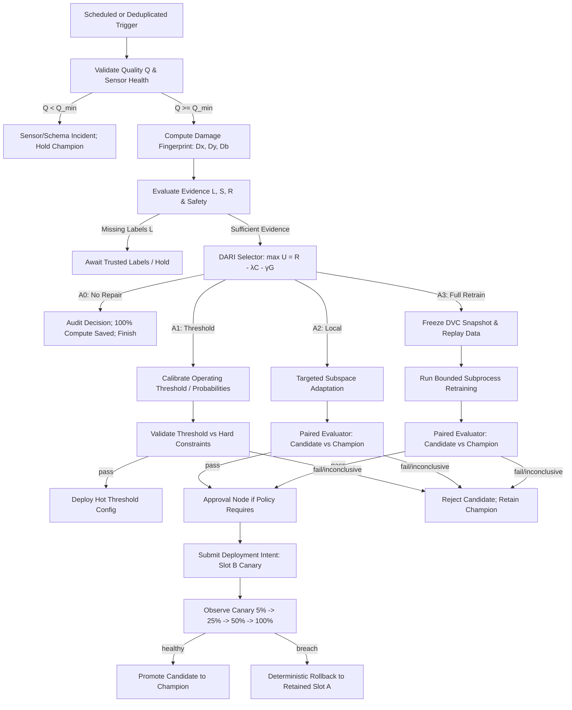

# SwayamKavach — 06 Agentic AI Layer

Four-role LangGraph design, state and tool contracts, bounded LLM autonomy, durable execution and lifecycle safety policies.

## Roles and the meaning of agentic

# 06 · Agentic AI Layer

**Design choice:** retain the four roles in the proposal, with finer deterministic graph nodes beneath each. A monitor, drift detector, retrain trigger, evaluator, deployer and rollback watcher are responsibilities—not necessarily six independent LLM conversations. More agents add communication/state overhead without automatically improving safety.

| Role | Trigger | Responsibilities and outputs | Prohibited authority |
|---|---|---|---|
| Monitoring Agent | Scheduled window or deduplicated signal | Validate sensor/schema; profile drift; join available labels; classify evidence; emit eligibility request | Cannot relabel traffic or rewrite the reference distribution |
| ML Engineer Agent | Eligible, budgeted lifecycle request | Select approved data/training plan; create immutable snapshot; train/register candidate; record lineage | Cannot execute arbitrary generated code, use final holdout or create labels |
| Evaluator Agent | Candidate complete | Same-data paired comparison, class/resource gates; PASS/FAIL/INCONCLUSIVE evidence | LLM cannot override tests or declare significance |
| Deployment Coordinator | Passing evidence + required approval | Request staging/rollout; observe progress; summarize outcome | Cannot directly access Docker, arbitrary Nginx config or policy edits |

**Independent deterministic services:** scheduler, job leases, inference consumer, deployment controller and rollback watcher. The watcher is not an LLM agent and must not wait for a graph's reasoning step.

## Two honest configurations
**Deterministic baseline:** LangGraph coordinates fixed conditional logic. Call this an autonomous lifecycle workflow; using LangGraph alone does not prove an LLM-based multi-agent contribution.

**Bounded agentic variant:** an LLM inspects sanitized structured evidence and proposes an allowed diagnosis or plan, such as `collect_more_labels`, `retrain_recent_plus_replay`, `evaluate_baseline_family`, or `escalate_sensor_fault`. A deterministic validator checks data eligibility, allowed estimator/configuration, compute budget and policy. Invalid proposals are rejected; timeout falls back to the deterministic plan or safe hold. Promotion and rollback remain deterministic.

The LLM can add explanatory/triage value without being entrusted with the security boundary. Evaluate that incremental value against the identical non-LLM workflow. Do not add four LLM calls merely to make a diagram look agentic.

## Graph, state and tools

## Graph topology (DARI-Enabled)


Waits are durable states or interrupts, not an active loop calling the LLM. When delayed labels arrive, an event resumes the graph at the DARI decision node.

```python
from typing import TypedDict, Literal

class DamageFingerprint(TypedDict):
    d_x: float          # Distribution damage [0, 1]
    d_y: float | None   # Performance damage [0, 1] or None if unlabelled
    d_b: float          # Boundary & uncertainty damage [0, 1]
    q: float            # Data quality score [0, 1]
    l: float            # Label reliability score [0, 1]
    s: float            # Sample sufficiency ratio [0, 1]
    r: float            # Persistence / multi-window score [0, 1]

class LifecycleState(TypedDict, total=False):
    job_id: str
    workflow_revision: str
    window_id: str
    reference_id: str
    schema_version: str
    policy_revision: str
    champion_release_id: str
    expected_generation: int
    damage_fingerprint: DamageFingerprint
    selected_action: Literal['A0', 'A1', 'A2', 'A3']
    action_type: Literal['NO_ACTION', 'HOT_THRESHOLD_UPDATE', 'CONTAINER_ROLLOUT']
    utility_breakdown: dict[str, float]
    monitoring_report_ref: str
    label_cutoff: str
    dataset_manifest_ref: str
    training_plan_ref: str
    mlflow_run_id: str
    candidate_release_id: str
    calibration_config_ref: str
    evaluation_ref: str
    evidence_hash: str
    decision: Literal['PASS', 'FAIL', 'INCONCLUSIVE', 'HOLD']
    approval_id: str
    deployment_operation_id: str
    attempts: int
    last_error_code: str
```

State holds immutable references, scalar metrics, and cryptographic hashes—never raw packets, DataFrames, passwords, or estimator instances.

## Tool contracts (DARI-Aware)
- `compute_damage_fingerprint(window_id, reference_id)` computes $D_X, D_Y, D_B, Q, L, S, R$ and returns a validated `DamageFingerprint`.
- `select_dari_repair(fingerprint, policy_revision)` applies hard constraints, evaluates $U(A_i) = R(A_i) - \lambda C(A_i) - \gamma G(A_i)$, and outputs the optimal $A^* \in \{A0, A1, A2, A3\}$.
- `calibrate_threshold(window_id, champion_id, objective)` fits optimal threshold $\theta^*$ and Platt/isotonic calibration parameters (Level A1).
- `freeze_snapshot(plan_id, label_cutoff)` builds immutable DVC manifest and split files for Level A2/A3 retraining.
- `train_candidate(snapshot_id, repair_level, resource_budget)` executes bounded localized ($A2$) or full ($A3$) model fit in an isolated subprocess.
- `evaluate_candidate(candidate_id, champion_id, eval_manifest, policy)` performs paired statistical gate validation.
- `request_threshold_deployment(threshold_config, evaluation_hash)` hot-reloads operating threshold in active slot.
- `request_slot_deployment(candidate_release_id, evaluation_hash, expected_generation)` initiates dual-slot canary rollout for Level A2/A3 models.

All arguments are validated for shape, provenance, permissions and semantic compatibility. Pydantic covers only part of this.

## Durability, guardrails and approval

## Durable execution
Use a dedicated worker with a Postgres checkpointer and stable `thread_id = job_id`. Initialize checkpointer tables as a migration, keep connection pools alive for worker lifetime, and record graph revision. Current LangGraph supports durability modes; synchronous checkpointing is a defensible choice around consequential steps, but still does not make external services transactional. [1–3]

```python
from langgraph.types import interrupt, Command

def approval_node(state):
    response = interrupt({
        'candidate_release_id': state['candidate_release_id'],
        'evidence_hash': state['evidence_hash'],
        'expected_generation': state['expected_generation'],
    })
    return {'approval_id': response['approval_id']}

# Authenticated API validates decision, then a worker resumes the same job:
# await graph.ainvoke(Command(resume=validated_payload), config)
```

The node restarts on resume. Keep external effects after the interrupt, in idempotent steps. The API verifies the approval record independently; an arbitrary resume payload is not authorization. Stale approvals are rejected after a champion, evidence or policy change. Do not wrap an interrupt in an exception handler that swallows it. Read state history for audits; replay can re-execute effects and is not a harmless log viewer. [2–3]

## Guardrail matrix
| Risk | Enforcement | Configuration/evidence |
|---|---|---|
| Repeated drift windows | Deduplicate by model/reference/window/signal; hysteresis | Stable-stream false-trigger calibration |
| Retraining loop | Cooldown, per-period budget, one active training job | Versioned policy and workload measurements |
| Non-beneficial retry | Retry transient failures only; terminal reject/inconclusive | Error taxonomy and decision ledger |
| Graph recursion | Finite per-job step budget and timeout | Stress tests; not a substitute for cross-job cooldown |
| Poisoned adaptation data | Trusted label provenance, quarantine and reviewed replay | Snapshot validation report |
| LLM unsafe proposal | Allowlist, schema and semantic validation, no shell | Rejected-proposal audit and deterministic fallback |
| Prompt injection | No raw payload/URL/log text as instructions; sanitized aggregates | Adversarial fixture tests |
| Budget exhaustion | Hard subprocess CPU/RAM/time and LLM token/call limits | Kill reason and explicit hold state |
| Split-brain worker | Lease/fencing and expected-generation checks | Crash/lease-expiry tests |
| Promotion on stale evidence | Bind release, policy, evaluation and predecessor | Approval expiry and 409 conflict tests |
| Rollback flapping | Quarantine failed release, no auto re-promotion | New review required |

Thresholds, cooldowns and call budgets are calibration/configuration decisions. No universal number is prescribed. Resource caps must still be set before running; a null/unconfigured mandatory safety limit prevents enabling full-auto mode.

## Failure handling and research claims

## Failure policy
- **No labels:** hold candidate promotion; request evidence. Old labelled data may support an explicitly designated maintenance experiment, but does not prove adaptation to new traffic.
- **LLM unavailable/invalid:** deterministic fallback or hold; never bypass a gate.
- **Training timeout/OOM:** terminate child; preserve serving releases; bounded retry only if resource policy changes or the failure was transient.
- **Registry response lost:** reconcile operation-tagged artifacts before registering again.
- **Controller unavailable:** deployment remains pending/degraded; graph cannot declare promotion.
- **Metric source lost during canary:** stop progression, follow explicit timeout/rollback policy.
- **Restart:** resume only from committed state and validate external reality before mutations.

## What to test about agentic value
Compare deterministic and LLM-assisted variants on the same scenarios, labels and compute budget. Measure correct action selection, invalid/unsafe proposals blocked, evidence-grounded explanation accuracy, human review time if actually studied, completed/held/failed cycles, cost and latency. Include harmless drift, sensor failure and missing-label cases—not just a scripted successful retrain.

The supplied BDaaS preprint is useful for role separation and artifact governance, but its controlled tabular evaluation does not establish IoT deployment safety. The supplied self-healing-agent preprint's experimental section says full results are still forthcoming; do not cite its abstract as completed validation. The IoT agent survey is a taxonomy and roadmap, not evidence that this specific integration is unprecedented. [4–6]

### Sources
1. [LangGraph Postgres memory/checkpoint setup](https://docs.langchain.com/oss/python/langgraph/add-memory).
2. [LangGraph interrupts](https://docs.langchain.com/oss/python/langgraph/interrupts).
3. [LangGraph time travel/replay](https://docs.langchain.com/oss/python/langgraph/use-time-travel) and [checkpointing](https://docs.langchain.com/oss/python/langgraph/checkpointers).
4. [Trustworthy self-composable BDaaS preprint](https://arxiv.org/abs/2606.17915).
5. [Self-healing LLM agents, supplied preprint reference](https://arxiv.org/abs/2605.06737).
6. [Nageshwaran & Ezekiel, IoT agentic cybersecurity survey](https://doi.org/10.3390/electronics15122740).

See 08 for evaluator gates and 09 for controller/watchdog behavior. This design deliberately separates reasoning proposals from infrastructure authority.
